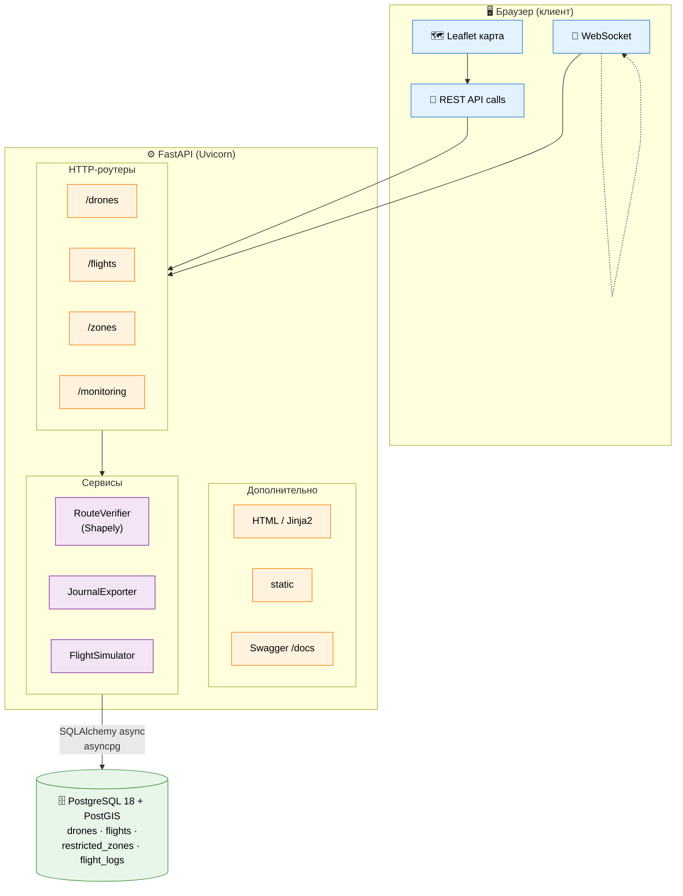

# Веб-система планирования, верификации и мониторинга полётных задач парка БВС


Автоматизированная система для операторов коммерческой авиации БВС.
Позволяет планировать маршруты на карте, автоматически проверять их
на пересечение с зонами ограничения воздушного пространства РФ,
отслеживать состояние парка в реальном времени и вести журнал полётов
с фильтрацией и экспортом.

---

## Содержание
- [Скриншоты](#скриншоты)
- [Возможности](#возможности)
- [Архитектура](#архитектура)
- [Требования](#требования)
- [Установка](#установка)
- [Настройка базы данных](#настройка-базы-данных)
- [Конфигурация](#конфигурация)
- [Запуск](#запуск)
- [API Reference](#api-reference)
- [Алгоритм верификации маршрутов](#алгоритм-верификации-маршрутов)
- [Структура проекта](#структура-проекта)
- [Тестирование](#тестирование)
- [Документация для разработчиков](#документация-для-разработчиков)

---

## Скриншоты

### Планирование маршрута


### Мониторинг


### Журнал полётов


## Возможности


### 📍 Планирование маршрута
- Интерактивная карта (OpenStreetMap / Leaflet)
- Добавление путевых точек кликом, перетаскивание маркеров
- Задание высоты полёта
- Отображение зон ограничения полётов в реальном времени

### ✅ Автоматическая верификация
- Проверка пересечения маршрута с зонами ограничения
- Учёт высотных границ каждой зоны (нижняя/верхняя)
- Классификация конфликтов: **критические** / **информационные**
- Оценка длины маршрута
- Автоматическое отклонение полётного задания при критических конфликтах

### 📡 Мониторинг парка БВС
- Отображение текущих координат всех БВС в полёте
- Обновление через WebSocket в реальном времени
- Панель со сводной статистикой (всего / в полёте / на базе / обслуживание)
- Лента событий с автообновлением

### 📖 Журнал полётов
- Хранение всех полётных заданий с полной историей событий
- Фильтрация: по статусу, БВС, датам, поиск по примечаниям
- Детальный просмотр каждого полёта (маршрут, верификация, телеметрия)
- Экспорт в **Excel (.xlsx)** и **CSV**
- Ручной импорт зон ограничения из GeoJSON-файлов

---

## Архитектура



**Поток данных:**
1. Оператор задаёт маршрут на карте Leaflet и отправляет его через REST API.
2. FastAPI принимает запрос, вызывает `RouteVerifier` (Shapely) для проверки пересечений с зонами.
3. Результат верификации и само полётное задание сохраняются в PostgreSQL через SQLAlchemy (async).
4. `FlightSimulator` в фоне двигает БВС по маршрутам и рассылает обновления через WebSocket всем подключённым клиентам.
5. Журнал полётов доступен с фильтрами и выгрузкой в Excel/CSV через `JournalExporter`.

### Стек технологий

| Слой       | Технология                                            |
|------------|-------------------------------------------------------|
| Backend    | Python 3.12.9, FastAPI, Uvicorn                       |
| ORM        | SQLAlchemy 2.0 (async), Alembic                       |
| БД         | PostgreSQL 18 + PostGIS                               |
| Геометрия  | Shapely 2.0, GeoAlchemy2, pyproj                      |
| Frontend   | Jinja2, Leaflet 1.9, Bootstrap 5, Vanilla JS          |
| Realtime   | WebSocket (встроен в FastAPI)                         |
| Экспорт    | pandas, openpyxl                                      |
| Логи       | Loguru                                                |

---

## Требования

- **Windows / Linux / macOS**
- **Python 3.12.9** — [python.org](https://www.python.org/downloads/)
- **PostgreSQL 18** с расширением **PostGIS** — [postgresql.org](https://www.postgresql.org/download/)
- **Git** — [git-scm.com](https://git-scm.com/)
- **VS Code** (рекомендуется) с расширениями:
  - Python
  - Pylance
  - SQLTools + PostgreSQL driver (для работы с БД из редактора)

---

## Установка

### 1. Клонирование проекта

```powershell
git clone <URL_РЕПОЗИТОРИЯ> uav-flight-system
cd uav-flight-system